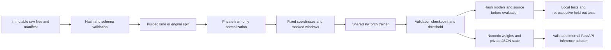
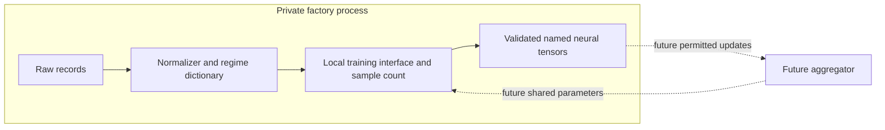

# Architecture V3

Frozen design, 2026-10-26, before V3 training. Scope: Phase 01/02/02.1 only.

## Audit and decisions

The ingestion validators, exact manifest audit, causal Azure windows, purged time
splits, NASA engine identities and official RUL mapping are reusable. Phase 01
removed constants independently, producing incompatible client dimensions; Phase
02 repaired them with a training union. V3 uses public fixed coordinates and
neutralizes locally constant coordinates. No target-domain variation defines inputs.

The sklearn baseline and optimization package duplicate training, checkpoints,
configuration and selection. They are superseded by one PyTorch trainer. Historical
reports and ignored outputs remain research records, retrievable with their original
code at f6a4e8e. Historical measurements are not V3 measurements.

The Phase 02.1 GRU correctly strips left padding before packing. Its N2 global
robust fallback is defensible, but small scales, unsupported regimes and different
local coordinate meanings remain limitations. N2 is a candidate reference, with
N0/N1 still supported; no new ranking or FD004-driven optimization is performed.
Azure error/maintenance availability is unverified. Telemetry-only is primary;
explicit event groups remain optional research ablations, never deployment claims.

## Components and data flow

Data modules own validation, splitting and preprocessing; model modules own neural
definitions, numeric serialization, metrics and one local training function;
experiment orchestration owns participation, source routing, freeze and evaluation.
The metadata preparation command uses the same raw validators and is an offline
catalog operation. It is run after experimental freeze because it describes holdouts.

Azure uses all 16 public telemetry summary coordinates (four sensors, mean/min/max/
count), a configurable compact MLP and BCE with logits. Locally constant count
coordinates are zero. NASA uses the sorted 24 public coordinates, 30-cycle windows,
explicit masks, GRU(24,32) and linear scalar head; the masked MLP is a control.
No IDs, future outcomes or targets enter features. NASA raw outputs are multiplied
by 100 after optimization, with no floor or cap. Uncapped truths remain unchanged.

## Training and evaluation

Keep Phase 01 target/split/holdout rules and Phase 02.1 NASA cycle-50/100 macro
validation RMSE. Azure selects by validation AP and validation-only best F1 threshold
(highest threshold tie). Adam, deterministic seeded shuffle, one CPU thread, 40
epochs, patience 6, lr .001, batch 128, alpha .0001. Loss is BCE or half scaled MSE
plus alpha/(2*N) squared weight penalty. Optional GPU is explicit configuration;
cross-device bitwise reproducibility is not promised. Fixed seeds 42/43.

Each local model sees one source client; the pooled offline reference sees the
concatenation of locally transformed sources. Pooled validation retains existing
per-task weighting. All models and thresholds freeze before held-out scoring.
Known sites use their own source-fitted transform; a local model uses its own
transform at the holdout. Pooled zero-shot routing uses maximum informative source
coordinates with lexical ties. No test chooses this route. Official terminal NASA
tests and correlated run-to-failure windows are separate pools. Held-out findings
are retrospective because of prior exposure, even after a new freeze.

## Future client/server and privacy boundaries

Only neural parameter names, shapes, dtypes and numeric tensors belong to the
export/import contract. Preprocessing, imputation values, regime dictionaries,
raw samples and client metadata stay separate. Local training accepts an epoch
budget and reports actual window/sample count; a subsequent orchestrator can use
this interface for weighted FedAvg and a later FedProx loss extension. Neither
algorithm, privacy mechanism nor communication protocol is implemented here.
Parameter bytes describe potential payload size, not measured network traffic.

Model updates can leak. Central pooling is non-private. Exporting source scalers
for zero-shot serving also discloses private statistics: bundles are trusted offline
research artifacts, not approved federated messages. Future threat-model-approved
deployment must resolve this tension without relabeling target fitting as zero-shot.

## Implementation plan

1. Preserve protected-input/historical-output hashes; consolidate reusable loaders,
   N0/N1/N2 normalization, masked windows and GRU.
2. Implement fixed feature contracts, validated batches, one trainer, safe numeric
   weights, independent private state and internal inference.
3. Exercise adversarial/data/model/API tests; train the fixed local/pooled panel,
   freeze choices, then evaluate and reload every prediction.
4. Remove superseded training paths, retain historical provenance, update current
   docs and review the complete diff and preservation evidence.
