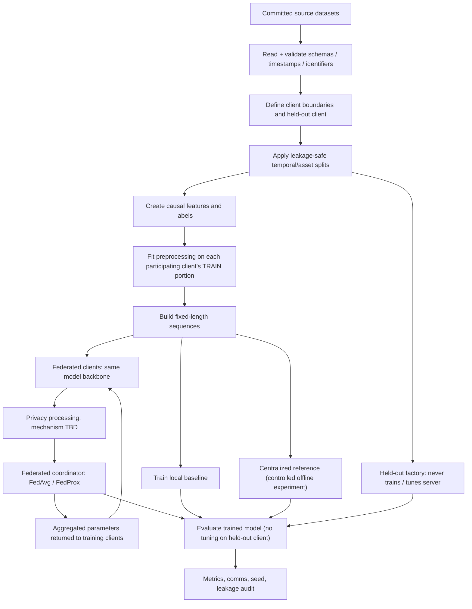
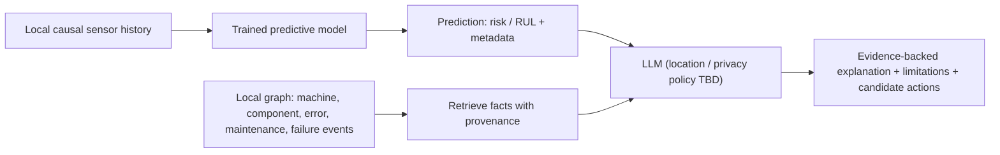

# Phase 1 — End-to-End Data Flow

> **Design draft, not implemented.** This document specifies the proposed data flow and boundaries. Values explicitly marked **candidate** require review and Phase 2 validation.

## 1. Two experimental tracks

| Track | Source files | Training task | Target | Role |
| --- | --- | --- | --- | --- |
| **A — Azure (primary)** | `data/Azure Data/PdM_*.csv` | Failure classification | Risk of a machine failure over a future time horizon | Federated classification, KG, LLM explanations |
| **B — NASA C-MAPSS** | `data/CMAPSSData/{train,test,RUL}_FD*.txt` | RUL regression | Remaining engine cycles until failure | RUL and cross-domain generalization benchmark |

**Keep the two tracks separate.** They may reuse code and protocols, but do not pool the input arrays or mix target definitions.

## 2. High-level training flow

The centralized baseline is an **offline comparison**, not the privacy-preserving deployment path. The specific privacy mechanism and leakage threat model are not finalized.

## 3. Azure: proposed operational flow

### Source tables and keys

| Source | Join key | Time field | Allowed use at prediction time `t` |
| --- | --- | --- | --- |
| `PdM_telemetry.csv` | `machineID` | `datetime` | Sensor values measured at/before `t` |
| `PdM_errors.csv` | `machineID` | `datetime` | Error events at/before `t` |
| `PdM_maint.csv` | `machineID` | `datetime` | Maintenance history at/before `t` |
| `PdM_machines.csv` | `machineID` | None | Machine metadata; avoid target-model leak under unseen-model testing |
| `PdM_failures.csv` | `machineID` | `datetime` | **Future records only for target creation**, never prediction inputs |

### Candidate label design

- **Prediction unit:** one machine at time `t`.
- **Task:** binary **any-component failure in `(t, t + 24h]`**; 24 h is an **unapproved candidate**.
- **Observation window:** prior **48 hourly readings** (candidate); stride **one hour** (candidate).
- **Outcome:** `1` if a relevant failure event occurs after `t` and by `t+24h`; `0` only if this whole horizon is observable and there is no event.
- Explicitly exclude unobservable tail horizons. Resolve whether records during a known failure/repair and repeated failure timestamps should be masked.
- Candidate feature sets: (1) **telemetry-only**; (2) telemetry + **causal** error/maintenance counts and component recency. Use only data available at each event cutoff.

**Example:** At 10:00, aggregate readings/events timestamped no later than 10:00, output `P(failure in next 24h)`. A failure at 14:00 may define the target but cannot appear in any feature at 10:00.

### Observed model distribution in the supplied Azure data

This is direct analysis of `PdM_machines.csv` joined with `PdM_failures.csv` from the project upload:

| Machine model | Machines | Failure-event records |
| --- | ---: | ---: |
| model1 | 16 | 189 |
| model2 | 17 | 168 |
| model3 | 35 | 221 |
| model4 | 32 | 183 |
| **Total** | **100** | **761** |

**These counts are not classification-positive label counts.** Class prevalence depends on windows, event handling and horizon.

### Proposed client / generalization protocol

**Protocol A (primary candidate):** Treat `model2`, `model3`, `model4` as three non-IID participating federated clients. Reserve all machines belonging to `model1` as an **unseen-model factory**. This allows a strict domain-shift test, but is only one choice; verify train/validation label counts before finalizing.

- The held-out model's raw data, labels, scaler parameters and updates are excluded from **training, hyperparameter selection and global-model preprocessing**.
- Set an explicit chronological training/validation cutoff on **participating-client** data. Purge any timepoints whose target horizon overlaps validation/test boundaries.
- Evaluate held-out machines only after the model and thresholds are locked. For a strict protocol, use **fixed inference-time preprocessing rules** defined on training data; if unsupervised local calibration is used, report it **separately** as adaptation rather than zero-shot.
- For the required analysis of client count, separately repartition training machines within known models using **whole-machine assignment**, never random row assignment. Do not mix this with the primary unseen-model result.

**Risk:** Only three participating model groups in the main protocol. This is sufficient to demonstrate the workflow, but results may have high client-level variance; the number-of-clients study needs a separate split.

## 4. NASA C-MAPSS: proposed RUL flow

- Source per subset: `train_FD00x.txt`, `test_FD00x.txt`, `RUL_FD00x.txt` (FD001 through FD004).
- Each row has engine ID, cycle, three operational settings and 21 sensor readings.
- Candidate observation window: previous **30 cycles** per engine, with padding/masking policies specified before implementation.
- Training RUL target at engine cycle `c`: `max_training_cycle_of_engine - c`, with any capped target documented and assessed.
- For the official test data, `RUL_FD00x.txt` gives the RUL **at the last recorded test cycle of each engine**. Earlier-cycle labels require explicit reconstruction from the endpoint RUL.
- **Candidate domain experiment:** train on a preselected set of FD domains and hold out another FD domain entirely. Tune and scale only on training domains. Keep official test data strictly for final scoring under the chosen protocol.
- **Caution:** The FD subsets have different operating conditions/fault modes. This makes the holdout intentionally challenging and does **not** represent observations from actual factories.
- C-MAPSS lacks Azure's error / maintenance tables. Do not fabricate per-component repair evidence for its LLM output.

## 5. Client-local preprocessing and strict holdout

- Partition by whole machine/engine and client **before fitting any statistics or selecting features**.
- Apply only training-derived, causal transformations; no look-ahead interpolation or test-aware variable selection.
- **Training clients:** fit normalizers using their own training windows, store local scalers locally. Document how the shared model consumes features on a consistent scale.
- **Unseen factory:** for the **strict zero-shot result**, do not fit model parameters or calibrate scalers on the holdout dataset. Use a precommitted compatible normalization rule; report optional holdout-local unlabeled calibration as a distinct experimental setting.
- Ensure sequences never cross machine/engine boundaries or split boundaries.
- Log the exact machine IDs per client, seed, time cutoffs, label method, feature list and scaler strategy.

## 6. Inference → local KG → explanation

- The **knowledge graph is separate** from the predictive backbone in the initial design. A GNN is optional; start with graph retrieval for LLM grounding.
- KG facts need source row/table, timestamp and machine/component IDs. Distinguish **observed history** from a **causal diagnosis**.
- Data sent to any externally hosted LLM must undergo a separate privacy review. Until then, **LLM hosting/location is an open decision**.
- For outputs with insufficient evidence, return an uncertainty / insufficient-evidence explanation, not invented maintenance advice.

## 7. Contracts between packages (design only)

| Package | Primary planned output |
| --- | --- |
| `data` | `ClientSplit` metadata, `WindowDataset`, transformation/provenance record |
| `models` | Task-specific logits or RUL estimates with model metadata |
| `federated` | Client updates, rounds and aggregated weights |
| `privacy` | Protected update protocol / accounting and declared limitations |
| `knowledge_graph` | Facts with `source_table`, `source_row`, `timestamp` and `relation` |
| `explainability` | Text plus explicit `evidence_ids`, uncertainties and grounded candidate actions |
| `evaluation` | Per-client/held-out metrics, communication, multi-seed summaries |

**These are interface proposals**, not implemented classes or tested modules.

## Phase 1 blockers / reviews

1. Approve target unit/horizon, event treatment, and splits.
2. Choose between candidate unseen-model holdout and an unseen-client (same known models) variant; may report both.
3. Define zero-shot normalization for a brand-new factory.
4. Agree on model backbone, computing constraints and privacy threat model.
5. Decide whether explanation generation must run locally.

See [MODEL_DESIGN.md](MODEL_DESIGN.md), [EXPERIMENT_PROTOCOL.md](EXPERIMENT_PROTOCOL.md), and [DECISIONS.md](DECISIONS.md).
